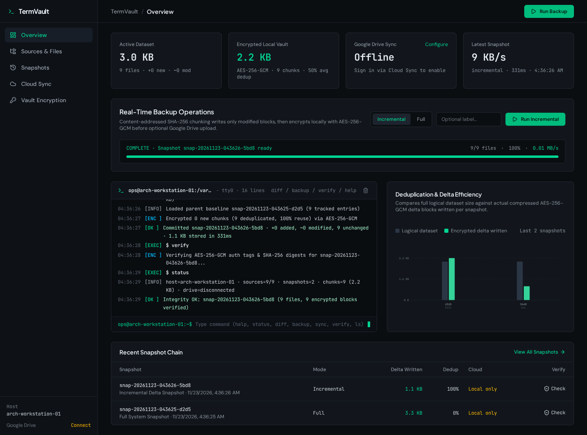

# TermVault

**TermVault** is a Linux backup application combining a retro phosphor terminal interface with modern operational cards. It provides content-addressed incremental deduplication, client-side AES-256-GCM encrypted local vault storage, real-time backup telemetry, and automated Google Drive cloud synchronization.



---

## Key Features

- **Incremental Block-Level Deduplication**: Splits source files into 16 KiB SHA-256 content-addressed chunks and compares against the parent snapshot manifest to track `added`, `modified`, `unchanged`, and `deleted` paths while persisting only new delta blocks.
- **Zero-Knowledge Local Encrypted Vault**: Derives 256-bit AES-GCM keys locally via Web Crypto PBKDF2-SHA256 (150,000 iterations) with a fresh 128-bit salt and 96-bit IV per block. Supports native Gzip pre-encryption compression, passphrase rotation, vault lock/unlock, cryptographic integrity verification, and offline `.tva.enc.json` archive export/import.
- **Automated Google Drive Synchronization**: Connects via Firebase Authentication (`GoogleAuthProvider`) using the least-privilege `https://www.googleapis.com/auth/drive.file` scope to manage encrypted archives inside a dedicated **`TermVault Backups`** folder. Supports auto-sync after every backup, scheduled background sync intervals (`Manual`, `5m`, `15m`, `60m`), pulling remote encrypted archives into the local vault, and mandatory confirmation dialogs before overwriting or deleting remote files.
- **Real-Time Status Reporting & Interactive Terminal (`tty0`)**: Streams live scanning, chunking, encryption, verification, and upload telemetry alongside an interactive CLI console and a Deduplication & Delta Efficiency chart.
- **Linux Source Manager**: Pre-loaded with representative Linux workstation configurations (`/etc/systemd`, `/etc/ssh/sshd_config`, `/etc/fstab`, `/etc/nginx`, `/var/lib/postgresql`, `/opt/stack/docker-compose.yml`, shell/editor dotfiles) plus drag-and-drop file/folder import, file creation, and inline editing to inspect live SHA-256 deltas.

---

## Interactive Terminal (`tty0`) Commands

The embedded terminal console drives the same underlying backup and synchronization engine as the UI controls:

| Command | Description |
| :--- | :--- |
| `help` | List all available CLI commands |
| `status` | Display host identifier, active source count, snapshot count, chunk store footprint, and Google Drive status |
| `diff` | Compute live SHA-256 delta (`added`, `modified`, `deleted`, `unchanged`) against the latest snapshot |
| `ls` | List committed snapshots with mode, encrypted delta size, deduplication ratio, and sync state |
| `backup` | Run an incremental encrypted backup against the latest parent snapshot |
| `backup --full` | Run a full encrypted backup snapshot |
| `sync` | Push all unsynced local encrypted snapshots to Google Drive |
| `verify [snapshot-id]` | Decrypt and verify AES-256-GCM authentication tags and SHA-256 block hashes (defaults to latest snapshot) |
| `clear` | Clear the terminal output buffer |

---

## Architecture & Security Model

### Cryptographic Pipeline (`src/services/cryptoEngine.ts`)
1. **Chunking & Hashing**: Files are segmented into 16 KiB blocks and hashed with `SHA-256` for content-addressed deduplication.
2. **Compression**: New chunks and snapshot manifests are optionally compressed using the browser's native `CompressionStream('gzip')`.
3. **Key Derivation & Encryption**: Each encrypted envelope derives a 256-bit key with `PBKDF2-SHA256` (`150,000` iterations, random 16-byte salt) and encrypts with `AES-256-GCM` (random 12-byte IV).
4. **Integrity Verification**: Decryption validates both the AES-GCM authentication tag and the plaintext `SHA-256` digest.

### Local Storage (`src/services/localVault.ts`)
- Persists encrypted content-addressed chunks (`chunks`), encrypted snapshot manifests (`snapshots`), and active workspace files (`sources`) in IndexedDB (`TermVaultEncryptedDB`).
- Deleting a local snapshot automatically runs garbage collection to remove unreferenced encrypted chunks.

### Google Drive Integration (`src/services/googleAuth.ts`, `src/services/googleDrive.ts`)
- **Least-Privilege Scope**: Requests only `https://www.googleapis.com/auth/drive.file`, restricting access to files and folders created by TermVault.
- **In-Memory Token Handling**: OAuth access tokens are cached strictly in memory and cleared automatically on sign-out via `onAuthStateChanged` (never written to `localStorage` or `sessionStorage`).
- **Explicit Mutation Safeguards**: Any destructive or mutating Drive operation (deleting a remote archive or overwriting an existing remote snapshot) requires explicit confirmation in a modal dialog detailing the affected file(s).

---

## Project Structure

```text
├── docs/
│   └── screenshots/
│       └── termvault-ui.png          # Live dashboard UI screenshot
├── src/
│   ├── components/
│   │   ├── CloudSyncView.tsx         # Google Drive OAuth, automation cadence & remote archive list
│   │   ├── ConfirmDialog.tsx         # Confirmation modal for destructive & Drive-mutating actions
│   │   ├── GoogleSignInButton.tsx    # Official Google Sign-In Material button
│   │   ├── OverviewView.tsx          # 4-card metrics, backup runner, terminal & chart
│   │   ├── SnapshotsView.tsx         # Snapshot history, manifest inspector, verify & restore
│   │   ├── SourcesView.tsx           # Linux source tree, drag-and-drop import & inline editor
│   │   ├── TerminalConsole.tsx       # Retro phosphor tty0 live console & CLI input
│   │   ├── ThroughputChart.tsx       # SVG logical vs. encrypted delta efficiency chart
│   │   └── VaultEncryptionView.tsx   # Passphrase lock/rotate, IndexedDB stats & archive import
│   ├── services/
│   │   ├── backupEngine.ts           # Incremental chunking, diffing, verification & restore
│   │   ├── cryptoEngine.ts           # Web Crypto AES-256-GCM, PBKDF2-SHA256 & gzip compression
│   │   ├── googleAuth.ts             # Firebase Auth + GoogleAuthProvider in-memory token manager
│   │   ├── googleDrive.ts            # Google Drive v3 folder, list, multipart upload, pull & delete
│   │   └── localVault.ts             # IndexedDB encrypted chunk/snapshot store & Linux seed configs
│   ├── types/
│   │   └── backup.ts                 # Shared TypeScript interfaces
│   ├── App.tsx                       # Root application shell, state orchestration & auto-sync timer
│   ├── index.css                     # Tailwind CSS v4 theme, typography & terminal styling
│   └── main.tsx                      # React entry point
├── firebase-applet-config.json       # Provisioned Firebase Auth configuration
├── index.html                        # HTML entry point & Google Fonts (Plus Jakarta Sans, DM Sans, JetBrains Mono)
└── package.json
```

---

## Getting Started

### Prerequisites
- Node.js 20+
- npm or Bun

### Installation & Development
```bash
npm install
npm run dev
```

The application serves on `http://localhost:3000`.

### Type-Checking & Production Build
```bash
npm run lint
npm run build
```

---

## Tech Stack

- **Frontend**: React 19, TypeScript, Vite, Tailwind CSS v4, Lucide Icons
- **Typography**: Plus Jakarta Sans (Display), DM Sans (UI Body), JetBrains Mono (Terminal & Tabular Metrics)
- **Cryptography & Storage**: Native Web Crypto API (`AES-256-GCM`, `PBKDF2-SHA256`, `SHA-256`), `CompressionStream` (`gzip`), IndexedDB
- **Cloud Synchronization**: Firebase Authentication (`GoogleAuthProvider`) & Google Drive REST API v3
